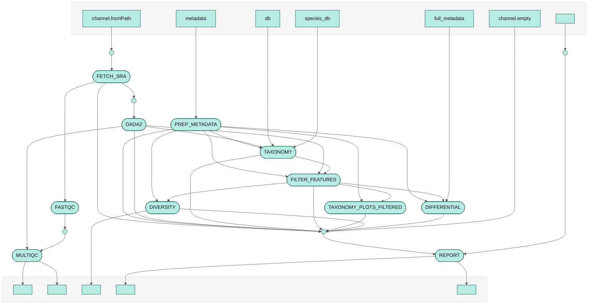

# BIOF501 - NextFlow Pipeline: Differential Abundance Analysis on Amplicon Sequencing Data

## Land acknowledgement statement

I acknowledge that this pipeline was developed at UBC's Vancouver campus, which is situated on the traditional, ancestral, and unceded territory of the xʷməθkʷəy̓əm (Musqueam) people. I also acknowledge the people of Colombia whose data are used in the example run, and the Indigenous peoples of the lands where the samples were collected. I am grateful for their contribution to open science, and I commit to using such data respectfully.

## Background and Rationale

Microorganisms are mostly single-celled organisms found almost everywhere, from the human body to soil (1). Microorganisms are the most abundant and diverse forms of life on Earth, and they have been present for billions of years (2). Microbiomes carry out functions that underpin ecosystems and health. In soil and water, microbes drive the carbon, nitrogen, and sulfur cycles, break down organic matter, and support primary production (3). In association with plants and animals, they supply nutrients, protect against pathogens, and influence immune and metabolic function (4). In humans, communities especially in the gut contribute to digestion, vitamin synthesis, and immune training (5). Microbes are also exploited in agriculture, bioremediation, food production, and biotechnology (6). Thus, it is evident that microbiomes play important roles in different contexts.

Because these functions depend on which microbes are present and in what proportions, changes in community composition are of broad biological interest. Shifts in composition have been associated with human diseases, differences in diet, response to drugs, amongst other conditions (7-9). Furthermore, communities can be compared at two levels. Alpha diversity describes the diversity within a single sample, such as how many different taxa are present (richness) and how evenly individuals are spread among them (evenness) (10). Next, beta diversity describes how different communities are from one another, and tests whether samples from different conditions differ in overall composition (11). Reduced diversity has been linked to disease states and to lower stability and resilience in some systems (12, 13). 

Therefore, a central question across fields is how diverse each community is, how communities differ between conditions, and which specific taxa drive those differences. Alpha and beta diversity adress the first two questions, respectively. Differential abundance analysis addresses the latter one by identifying taxa whose abundance changes with a variable of interest.

Communities are commonly profiled by sequencing the 16S ribosomal RNA gene (14). This gene is present in all bacteria and archaea and contains conserved regions, which allow universal PCR primers (14). Interspersed with the conserved regions, there are variable regions, which differ enough between taxa to identify them (14). The reads are grouped into amplicon sequence variants (ASVs), classified into taxa, and the resulting table of counts per taxa per sample is compared across the condition of interest. Thus, this Nextflow pipeline analyzes 16S rRNA amplicon data to answer the following questions:

- How diverse is each sample (alpha diversity) and how different are the samples from each other (beta diversity)?
- Which taxa are more or less abundant when a variable of interest changes?

## Pipeline steps

This pipeline requires at the minimum a CSV metadata file with one row per sample. The first column should correspond to the SRA accession numbers of the samples of interest, whose path is specified with the parameter `metadata`. There should also be another column in the metadata that will serve as the variable of interest, whose name can be specified with the parameter `variable`. The SRA accession numbers must correspond to Illumina 16s rRNA samples. An example of what this file should look like can be found in `data/data_raw/colombia_metadata.csv`.

The major steps in the pipeline are:

1. Fetch reads: downloads the SRA runs specified by the user (must be public accessions specified in the first column of the metadata file), converts it to FASTQ with `fasterq-dump`, optionally cuts it to the first `max_reads` reads, and compresses the result.
2. Metadata preparation: checks the metadata and the chosen variable, decides if it is numeric or categorical, writes a clean table and plots the distribution of the variable (histogram or barplot depending on if it is numeric or categorical).
3. Denoising with DADA2 (15): truncates reads before the first position the median falls below Q30 (quality threshold can be specified with `auto_trunc_q`, or override it by specifying numbers of bases to trim with `--trunc_f` and `--trunc_r`) and will also generate aggregated quality profiles. Reads are also discarded if they have more than `max_ee`. Then, learns the error model, denoises, merges pairs if applicable, and removes chimeras. Also runs FastQC and MultiQC (16, 17) to generate a report on the QC of the reads. At the end, a table of ASVs is generated.
4. Classifying taxonomy: classifies the ASVs into taxa against a SILVA (18) dataset using DADA2's naive Bayesian classifier. The default one used is SILVA nr99 v138.1, but a different one can be specified with `silva_db` and `silva_species_db`. It can be an URL or a local path. `silva_species_db` is needed as a reference for the species-level assignment step. It will also generate bar plots of the total and relative abundance of each classified taxa for each sample. The taxa level can be specified by the user with `tax_level` (default is family).
5. Filtering: keeps only samples present in both the counts and the metadata, drops ASVs that are unassigned, drops mitochondrial or chloroplast ASVs, removes samples with fewer reads than `min_depth` (default 1000), discards ASVs left with zero counts, and aggregates the ASVs to the requested taxonomic level (specified by `tax_level`, default is family). It will also generate bar plots of the total and relative abundance of each classified taxa for each sample, after filtering.
6. Diversity: rarefies by the smallest sample, but it can be overriden with `rarefaction_depth`. A rarefaction curve will also be generated for inspection at this step. Then, computes Shannon's diversity index (19) for alpha diversity and Bray-Curtis dissimilarity (PCoA) (11) for beta diversity, and tests them against the variable. For Shannon's diversity, if the variable is numeric it will do Spearman correlation, Wilcoxon rank-sum for 2 levels of a categorical variable, and Kruskal-Wallis with pairwie Wilcoxon BH-adjusted for 3 or more levels of a categorical variable. For Bray-Curtis, it will do PERMANOVA for a numerical variable, and PERMANOVA+PERMDISP for a categorical variable.
7. Differential abundance analysis with DESeq2 (20): uses DESeq2 to perform differential abundance analysis on the filtered counts aggregated at the `tax_level`, can be optially adjusted for covariates with `da_covariates`. 
8. Report: makes an HTML report to collect all the outputs.



## Usage

### Core dependencies and pipeline tools

This pipeline depends on the 2 following dependencies:

- [Nextflow](https://www.nextflow.io) >= 26.04.0 
- [Docker](https://docs.docker.com/get-docker/) >=29.9.0

The pipeline also uses the following Docker images (no need to download):

- sra-tools 3.1.1 to download reads from SRA
- FastQC 0.12.1 for per-sample read quality
- MultiQC 1.25.1 for summary of FastQC results
- DADA2 1.34.0 for denoising and taxonomy classification
- Bioconductor image with vegan, ggplot2, and phyloseq 1.50.0 for metadata checks, filtering, diversity, and making the report
- DESeq2 1.46.0 for differential abundance analysis

### Installation of the core dependencies

Note that Nextflow (21) requires Bash 3.2 (or later) and Java 17 (or later, up to 26). Please make sure you have these installed in your system with the right version.

To install Nextflow on Linux, macOS, or Windows through WSL2:

```bash
# download nextflow
curl -s https://get.nextflow.io | bash

# make nextflow executable
chmod +x nextflow

# move nextflow in an executable. for example:
mkdir -p $HOME/.local/bin/
mv nextflow $HOME/.local/bin/

# confirm nextflow is installed correctly
nextflow info
```
To install Docker, you will first need to create an account [here](https://app.docker.com/signup?next=%2F%3Fref%3Dlogin).

Then, scroll down to the bottom of [this page](https://docs.docker.com/desktop/) and click on Windows/Mac/Linux under "Install Docker Desktop". Follow the instructions on the page to install Docker Desktop. Once installed, login into your newly created account.

- If you are on Mac, you can type the following to make sure the installation was successful:

```bash
docker run hello-world
```

- If you are on Windows through WSL2, make sure you enable WSL integration on Docker Desktop (under "Settings", "WSL integration). Then run the following to make sure the installation was successful:

```bash
docker run hello-world
```

- If you are on Linux, you will need to install Docker CE for Ubuntu by following [these instructions](https://docs.docker.com/engine/install/ubuntu/#install-using-the-repository), under "Install using the apt repository". Next, follow the Linux post-installation steps [here](https://docs.docker.com/engine/install/linux-postinstall/), under "Manage Docker as a non-root user". Confirm that docker is working by following the verification instructions on that same page.

### Running the pipeline

Ensure you have Docker Desktop running before proceeding, as well as an SSH key set up.

```bash
# get repository
git clone git@github.com:xnrxng/biof501_nextflow.git

# go to the root of the repository
cd biof501_nextflow

# to run the toy example, you can do this:
nextflow run main.nf

# you can specify other parameters (outlined below) by adding 2 dashes. for example:
nextflow run main.nf --metadata data/data_raw/colombia_metadata.csv --variable BMI_class --tax_level genus

#  re-use finished steps after changing something:
nextflow run main.nf -resume
```

### Parameters

- `metadata`: path to the metadata file, in the format specified above. Default is `data/data_raw/colombia.metadata.csv`.
- `variable`: name of the column on the metadata file that will serve as the response variable. Default is `adiponectin`.
- `variable_type`: type of the variable of interest. Can be `numeric`, `categorical` or `auto` (default).
- `outdir`: folder where the results are saved. Default is `results`.
- `rawdir`: folder where the downloaded FASTQ files are stored. Default is `data/data_raw`.
- `procdir`: folder where the main processed tables are saved. Default is `data/data_processed`.
- `max_sra_size`: largest single SRA run that is allowed to be downloaded. Default is `20G`.
- `max_reads`: number of reads kept per sample after download. Default is `0` (keeps all of them).
- `trunc_len_f` and `trunc_len_r`: position at which the forward and reverse reads are truncated, and reads shorter than this are discarded. Can be `auto` (see `auto_trunc_q` and `auto_trunc_floor`), `0` for no truncation, or an integer for a fixed length. Default is `auto` for both.
- `auto_trunc_q`: only used if `trunc_len_f` or `trunc_len_r` is `auto`. Phred quality threshold: reads are truncated right before the first position where the median quality falls below it. Default is `30`.
- `auto_trunc_floor`: only used if `trunc_len_f` or `trunc_len_r` is `auto`. Shortest length that `auto` is allowed to choose. Default is `50`.
- `trim_left_f` and `trim_left_r`: number of bases removed from the start of the forward and reverse reads. Set them to the primer length if the primers are still in the reads. Default is `0` for both.
- `max_ee`: maximum number of expected errors allowed in a read after truncation. Default is `2`.
- `silva_db`: URL or local path to a reference training set used to classify the ASVs. Default is SILVA nr99 v138.1 from Zenodo [record 4587955](https://zenodo.org/records/4587955).
- `silva_species_db`: URL or local path to a reference used for the species-level assignment. Default is the SILVA v138.1 species assignment file from Zenodo [record 4587955](https://zenodo.org/records/4587955).
- `min_boot`: minimum bootstrap confidence (0-100) needed to keep a taxonomic assignment at a given rank. Default is `50`.
- `min_depth`: samples with fewer reads than this after removing non-microbial ASVs are dropped. Default is `1000`.
- `tax_level`: taxonomic level at which taxa are grouped for downstream analyses. It can be `phylum`, `class`, `order`, `family`, `genus`, `species` or `asv` (no grouping). Default is `family`.
- `rarefaction_depth`: number of reads every sample is randomly subsampled to before computing alpha and beta diversity. `0` (default) uses the smallest sample.
- `da_binarize`: only for numeric variables. `none` (default) tests the variable as a continuous effect, while `median` splits the samples at the median into a low and a high group.
- `da_reference`: only for categorical variables. Reference level that all other levels are compared against in the differential abundance analysis. If empty (default), the first level in alphabetical order is used.
- `da_covariates`: other metadata columns to add as covariates, separated by commas and without spaces (e.g. `age_years,sex`). Numeric covariates are standardised, and SAMPLES WITH A MISSING COVARIATE VALUE ARE DROPPED. Default is empty.
- `da_covariate_refs`: reference levels of the categorical covariates, written as `column=level` pairs separated by commas (e.g. `sex=female,city=Bogota`). Default is empty.
- `da_alpha`: adjusted p-value threshold. Default is `0.1`.
- `da_lfc`: absolute log2 fold-change threshold. Default is `0.5`.
- `da_min_prev`: minimum fraction of samples in which a taxon must be present to be tested. Default is `0.2`.

### Directory structure

```
biof501_nextflow/
├── main.nf                  main workflow
├── nextflow.config          contains parameters and Docker settings
├── modules/                 Nextflow modules for each step
├── bin/                     scripts the modules run
├── data/
│   ├── data_raw/            metadata CSV and downloaded FASTQ files
│   └── data_processed/      ASV table, ASV sequences, taxonomy, filtered ASV table, taxa counts, rarefied counts
├── results/                 outputs, contains initially example results (see "Toy example")
```

### Outputs

Main data tables are under `data/data_processed/`. For what is inside the `results` folder:

```
results/
├── 01_prelim_eda/
│   └── variable_distribution.png        distribution of the variable of interest (histogram or bar plot)
├── 02_metadata/
│   ├── variable_info.tsv                information on the variable of interest
│   └── metadata_clean.tsv               sample IDs with the values of the variable
├── 03_dada2_multiqc/
│   ├── read_tracking.tsv                reads kept in each DADA2 step per sample
│   ├── error_rates.png                  error model learned by DADA2
│   ├── quality_profiles_forward.png     aggregated quality profiles of the forward reads
│   ├── quality_profiles_reverse.png     same for the reverse reads (paired-end data only)
│   └── multiqc/
│       ├── multiqc_report.html          MultiQC report on the read quality
│       └── multiqc_report_data/         data behind the MultiQC report
├── 04_taxonomy/
│   ├── taxa_absolute_unfiltered.png     reads per taxon in each sample before filtering
│   ├── taxa_relative_unfiltered.png     relative abundance per taxon in each sample before filtering
│   ├── taxa_absolute_filtered.png       reads per taxon in each sample after filtering
│   ├── taxa_relative_filtered.png       relative abundance per taxon in each sample after filtering
│   └── taxonomy_db_info.tsv             reference databases used
├── 05_filtered/
│   ├── filter_summary.tsv               ASVs, reads and samples remaining after each filtering step
│   └── metadata_filtered.tsv            metadata of the samples that passed filtering
├── 06_diversity/
│   ├── rarefaction_curve.png            ASVs observed as more reads are sampled
│   ├── alpha_diversity.png              Shannon diversity against the variable
│   ├── alpha_diversity.tsv              Shannon diversity of each sample
│   ├── alpha_stats.tsv                  statistical test for alpha diversity
│   ├── beta_diversity.png               PCoA of the Bray-Curtis dissimilarity
│   ├── beta_stats.tsv                   statistical test for beta diversity
│   ├── bray_curtis_matrix.tsv           Bray-Curtis dissimilarity between all pairs of samples
│   └── pcoa_coords.tsv                  PCoA coordinates of each sample
├── 07_differential_abundance/
│   ├── da_results.tsv                   DESeq2 results
│   ├── da_volcano.png                   volcano plot
│   └── da_top_features.png              barplot of log2 fold-change of the 20 taxa with smallest p-values
├── 08_report/
│   ├── report.html                      final report
│   └── provenance.json                  parameters of the inputs and main outputs
└── pipeline_info/                       Nextflow execution report, timeline, trace and DAG
```

## Toy example

This repository includes an example run under `results`. The data used are 6 out of 441 samples that come from de la Cuesta-Zuluaga et al. (22). These 6 stool samples correspond to 6 male donors that were undergoing changes in lifestyle due to westernization in Colombia in 2014 (22). None  of  the  participants  were  underweight  (Body  Mass  Index <18.5 kg/m²), pregnant, consumed antibiotics or antiparasitics three months before sample collection, with cancer, with gastrointestinal diseases, or with neurodegenerative diseases (22). The   DNA   from   each   sample   was   collected   and   barcoded   primers   F515 (5′-GTGCCAGCMGCCGCGGTAA-3′)  and  R806  (5′-GGACTACHVGGGTWTCTAAT-3′) primers  were  used  to  amplify  the  V4  hypervariable  region  of  the  16S  rRNA  gene  using Illumina MiSeq (22). The FASTQ files are not stored in the repository and are downloaded the first time you run the pipeline with the default parameters.

In the example run, it uses the metadata found in `data/data_raw/colombia_metadata.csv` and `adiponectin` as the response variable (numerical variable). Everything else is default. 

```bash
nextflow run main.nf
```

## Acknowledgements

I am immensely grateful to de la Cuesta Zuluaga et al. (22) for making their data public for re-analysis, as well as the donors for being willing to have their samples analyzed. I am also grateful to Berke Ucar, Dr. Inanc Birol, Dr. Ewan Gibbs and the 2026 cohort of BIOF501 for their support. Lastly, I am grateful to Dr. Paul Pavlidis, Michael Smith Laboratories, and UBC for providing me with the resources needed to make this pipleine.

## Statement on Usage of Generative AI

Claude was used in the following ways:

- pointed out edge cases I had missed and suggested added code (e.g. automatic truncation), as well as parameters (e.g. max_sra_size) to handle those cases
- reminded me of functions I had forgotten or did not know the code of (e.g. merging forward and reverse reads)
- pointed out cases where code syntax was not correct
- pointed out outputs I should consider in adding (e.g. provenance files)
- helped with debugging when the pipeline would get stuck in some errors
- as it is my first time working with Nextflow, navigated me through starting a Nextflow pipeline, its components, its code syntax, amongst other aspects of working with Nextflow
- generated the tree stucture for the directory and `results` folder (only the tree structure, NOT the explanation of each file)

I declare that the rest of the work, the ones not aforementioned in the list, is my own work. This includes but not limited to: coming up with the pipeline idea, designing the pipeline steps, looking for the example data, writing the README and main code, organizing the repository structure (folders, names of files), creating the presentation and script linked to this pipeline, amongst other work.

## References

1. Cockell C. S. (2021). Are microorganisms everywhere they can be?. *Environmental microbiology, 23*(11), 6355–6363. https://doi.org/10.1111/1462-2920.15825
2. Schopf, J. W., Kitajima, K., Spicuzza, M. J., Kudryavtsev, A. B., & Valley, J. W. (2018). SIMS analyses of the oldest known assemblage of microfossils document their taxon-correlated carbon isotope compositions. *Proceedings of the National Academy of Sciences of the United States of America, 115*(1), 53–58.
3. Imtiaz, A., Mondal, R., Nesa, J., Amit Kumar, M., & Sadat, A. (2025). Understanding the role of soil microbiota and its” interplay with environment to ensure sustainable development for the future generations. *Applied Soil Ecology, 212*, 106217. https://doi.org/10.1016/j.apsoil.2025.106217
4. Christian, N., Whitaker, B. K., & Clay, K. (2015). Microbiomes: unifying animal and plant systems through the lens of community ecology theory. *Frontiers in microbiology, 6*, 869. https://doi.org/10.3389/fmicb.2015.00869
5. Jandhyala, S. M., Talukdar, R., Subramanyam, C., Vuyyuru, H., Sasikala, M., & Nageshwar Reddy, D. (2015). Role of the normal gut microbiota. *World journal of gastroenterology, 21*(29), 8787–8803. https://doi.org/10.3748/wjg.v21.i29.8787
6. Flores, A. I., Morales-Cedeño, L. R., Loeza-Lara, P. D., Schoebitz, M., Orozco-Mosqueda, M. D. C., & Santoyo, G. (2026). Engineering Plant-Associated Microorganisms for Bioremediation and Sustainable Agriculture. *Microorganisms, 14*(6), 1203. https://doi.org/10.3390/microorganisms14061203
7. Li, X., Yuan, Q., Huang, H., & Wang, L. (2025). Gut microbiota in irritable bowel syndrome: a narrative review of mechanisms and microbiome-based therapies. *Frontiers in immunology, 16*, 1695321. https://doi.org/10.3389/fimmu.2025.1695321
8. Zhang P. (2022). Influence of Foods and Nutrition on the Gut Microbiome and Implications for Intestinal Health. *International journal of molecular sciences, 23*(17), 9588. https://doi.org/10.3390/ijms23179588
9. Pereira, F. C., & El Aidy, S. (2026). Drug-microbiome interactions: What we know and why predictive translation remains elusive. *Gut microbes reports, 3*(1), 2649166. https://doi.org/10.1080/29933935.2026.2649166
10. Willis A. D. (2019). Rarefaction, Alpha Diversity, and Statistics. *Frontiers in microbiology, 10*, 2407. https://doi.org/10.3389/fmicb.2019.02407
11. Bray, J. R., & Curtis, J. T. (1957). An ordination of the upland forest communities of Southern Wisconsin. *Ecological Monographs, 27*(4), 325–349. https://doi.org/10.2307/1942268
12. Mosca, A., Leclerc, M., & Hugot, J. P. (2016). Gut Microbiota Diversity and Human Diseases: Should We Reintroduce Key Predators in Our Ecosystem?. *Frontiers in microbiology, 7*, 455. https://doi.org/10.3389/fmicb.2016.00455
13. Gong, D., Gong, X., Wang, L., Yu, X., & Dong, Q. (2016). Involvement of Reduced Microbial Diversity in Inflammatory Bowel Disease. *Gastroenterology research and practice*, 2016, 6951091. https://doi.org/10.1155/2016/6951091
14. Janda, J. M., & Abbott, S. L. (2007). 16S rRNA gene sequencing for bacterial identification in the diagnostic laboratory: pluses, perils, and pitfalls. *Journal of clinical microbiology, 45*(9), 2761–2764. https://doi.org/10.1128/JCM.01228-07
15. Callahan, B. J., McMurdie, P. J., Rosen, M. J., Han, A. W., Johnson, A. J., & Holmes, S. P. (2016). DADA2: High-resolution sample inference from Illumina amplicon data. *Nature methods, 13*(7), 581–583. https://doi.org/10.1038/nmeth.3869
16. Andrews, S. (2010). *FastQC a quality control tool for high throughput sequence data.* Babraham.Ac.Uk. https://www.bioinformatics.babraham.ac.uk/projects/fastqc/
17. Ewels, P., Magnusson, M., Lundin, S., & Käller, M. (2016). MultiQC: summarize analysis results for multiple tools and samples in a single report. *Bioinformatics (Oxford, England), 32*(19), 3047–3048. https://doi.org/10.1093/bioinformatics/btw354
18. Quast, C., Pruesse, E., Yilmaz, P., Gerken, J., Schweer, T., Yarza, P., Peplies, J., & Glöckner, F. O. (2013). The SILVA ribosomal RNA gene database project: improved data processing and web-based tools. *Nucleic acids research, 41*(Database issue), D590–D596. https://doi.org/10.1093/nar/gks1219
19. Shannon, C. E. (1948). A mathematical theory of communication. *Bell System Technical Journal, 27*(3), 379–423. https://doi.org/10.1002/j.1538-7305.1948.tb01338.x
20. Love, M. I., Huber, W., & Anders, S. (2014). Moderated estimation of fold change and dispersion for RNA-seq data with DESeq2. *Genome biology, 15*(12), 550. https://doi.org/10.1186/s13059-014-0550-8
21. Di Tommaso, P., Chatzou, M., Floden, E. W., Barja, P. P., Palumbo, E., & Notredame, C. (2017). Nextflow enables reproducible computational workflows. *Nature biotechnology, 35*(4), 316–319. https://doi.org/10.1038/nbt.3820
22. de la Cuesta-Zuluaga, J., Corrales-Agudelo, V., Velásquez-Mejía, E. P., Carmona, J. A., Abad, J. M., & Escobar, J. S. (2018). Gut microbiota is associated with obesity and cardiometabolic disease in a population in the midst of Westernization. *Scientific reports, 8*(1), 11356. https://doi.org/10.1038/s41598-018-29687-x